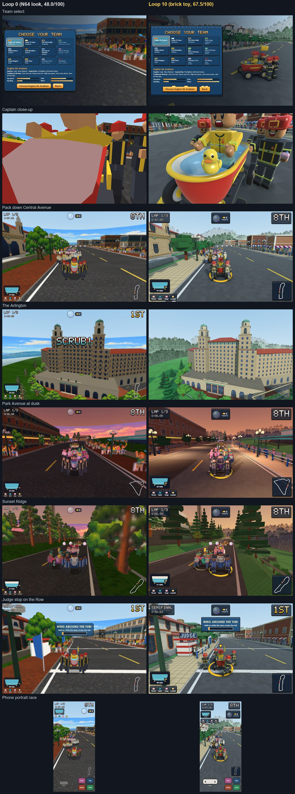

# Spa City Tub Rally: report

An original bathtub kart racer on the real streets and mountain roads of Hot Springs, Arkansas, inspired by the
World Championship Running of the Tubs. Built M0–M5 per `DEV-PLAN.md` in an N64 style, then restyled as a glossy
brick-toy world (see the brick campaign section below).

## What was built
- **Eight courses from real data** (OpenStreetMap streets and buildings, USGS 3DEP elevation), routed, compressed
  to ~1 km laps (45–60 s), checked and balanced:

| Course | Cup | Real → raced | Notes |
|---|---|---|---|
| Bathhouse Row | Bathhouse | 1,610 m → 1,010 m | Central Ave past the eight bathhouses **at true scale** in the HABS order; Grand Promenade (game course); 10 landmark models + Medical Arts + Army-Navy |
| Park Avenue Nights | Bathhouse | 1,937 → 1,000 m | dusk, neon bands, swing theme; the Vapors block pinned at true scale (Vapors position approximate); the Arlington |
| Whittington Valley | Bathhouse | 2,554 → 1,000 m | both one-way halves of Whittington Ave around the park; a private lot on the old ballpark site raced as a labelled game-course link |
| Bridge Street Bash | Bathhouse | 1,865 → 1,020 m | Bridge St (54 m OSM, pinned) and Malvern; stops ~130 m short of the 2016 finish plaza so no real building straddles the road |
| Hot Springs Mountain Drive | Ouachita | 4,465 → 1,050 m | all 7 switchbacks of the lower climb, the Pagoda, the Tower (models) |
| Goat Rock & Gulpha Gorge | Ouachita | 6,982 → 1,050 m | Goat Rock overlook (model), the Gulpha Gorge Trail ford; about half the real loop is footpaths raced as dirt (game course) |
| West Mountain Summit | Ouachita | 3,936 → 1,000 m | Prospect entrance, Row-view overlooks, Lake Hamilton overlook; return on trails (game course); the 1924 shelter placed approximately |
| Sunset Ridge | Ouachita | 1,778 → 1,000 m | **changed from plan**: the Sugarloaf/Music Mountain roads only form 10–17 km loops, so this is the Hot Springs Mountain summit circuit at sunset (Tower, Pagoda) |

- **Arena**: Hill Wheatley Plaza (Water Fight) around the plaza's thermal jug fountain, real buildings around it.
- **Modes**: Grand Prix (two cups, standings, Golden/Silver/Bronze Faucet, unlocks), Quick Race, Time Trial with
  saved pose ghosts, **Rules of the Row** (division bracket heats down Central with judge stops: Ring Around the
  Tub, Bath Toss, Jumping Jacks, Push-ups, Yodeling; disqualification under 10 gal or a missing item; Battle of the
  Badge exhibition; awards ceremony), **Water Fight**.
- **The real rules as mechanics**: captain + four attendants (towel, mat, soap, loofah), water as ballast and
  health with the 10-gallon line, fumble → circle the tub, grip slip, rubber duck and flag on every tub, hats and
  suspenders, bath-ticket bribes for a Head Start at judge stands (blue feather flags), crowd blasters and refill
  buckets.
- **12 fictional teams** in three divisions with distinct handling; 9 original bath-themed items (no leader-
  targeting item); AI with racing lines, slides, item use, water discipline.
- **Presentation**: 240-line renderer (Authentic/Crisp/Native), gamma-space custom shaders, Codex-painted 64 px
  textures (5-bit dither) and painted ridge panoramas, 20 Blender landmark models, procedural tubs/crews with
  rigid-part animation (one draw per tub), particles, original pixel font HUD, menus, synthesized sound and four
  original sequenced themes (rag, swing, bluegrass, march).

## Acceptance criteria (PRD §12)
| AC | Status | Evidence |
|---|---|---|
| AC1 boot, zero errors/requests, http + file:// | met | final + final-fileurl suites |
| AC2 240-line Authentic, Crisp, Native | met | m0 boot; settings |
| AC3 countdown → laps → results, checkpoints | met | m0/m2 race tests |
| AC4 deterministic (Node = browser hash) | met | m1 determinism (items on) |
| AC5 push, brake, steer, hop, Warm/Hot slides | met | m0 slide, m1 lap |
| AC6 water spill/refill, gauge | met | m2 water tests, balance tool |
| AC7 fumble and circle | met | m2 circle |
| AC8 Clean Finish | met | m2 results |
| AC9 walls, drops + referee tow, off-road | met (drops rare on current courses) | check/balance (0 walls, 0 falls for AI) |
| AC10 AI on every course | met | check.mjs: 8 AI × 3 laps on all courses |
| AC11 nine items, odds by place | met | m2 items, balance hit rates |
| AC12 tickets and judge stands | met | m2 judge test |
| AC13 eight real-data courses with distortion notes and landmarks | met (Sunset Ridge changed; see table) | tracks/*.notes.md, m3 course + landmark tours |
| AC14 the Row in order | met | m1 row order (node) |
| AC15 12 teams, 3 divisions, unlocks | met | m2 menus; balance division shares |
| AC16 GP, TT ghost, Water Fight, Rules of the Row | met | m1 ghost, m2 GP menus, m3 battle + row |
| AC17 screens, keyboard/gamepad navigable | met | m2 menus keyboard-only, gamepad test |
| AC18 synth music and SFX, toggles | met (not listened to by a human) | m4 audio |
| AC19 touch, no overflow, targets ≥ 44 px | met | m2 touch, checkLayout |
| AC20 reduced motion, contrast ≥ 4.5:1 | met | m4 contrast report |
| AC21 budgets | met | m5 (see below) |
| AC22 saves, storage blocked | met | m1 ghost after reload, m2 storage blocked |
| AC23 sourced facts | met | check-facts: 24/24 |
| AC24 originality checklist | met | PRD §14 reviewed each milestone |

**Visual review (M4).** Two blind critics scored the screenshots against `reviews/RUBRIC.md`: Claude 41.5/80,
Codex 46/80. No gate (≥ 7, authenticity ≥ 6) was met on that pass; readability and mobile were lowest (4.5). Their
shared top issues are fixed (DEV-PLAN D19–D26): camera clipping into scenery, the sea-like horizon, portrait framing,
dusk light on the ground, untextured walls, judge stops, and terrain from neighbouring switchbacks covering the road
on phones. The fixes were checked on reshot sheets but not re-scored.

## Tests and numbers
- `npm test -- --milestone final --gpu`: **66/66 pass**; `--file-url`: **65/65 pass** (after the review fixes).
- `node tools/track/check.mjs --all`: all 10 courses pass (incl. gray box and arena).
- `node tools/balance.mjs --track all` (Soak, 96 races): laps 53.5–56.8 s mean per course; water at the finish
  0.44–0.60 of capacity; division wins Traditional 28%, Modified 38%, Stock 33%; ~9–13 item hits per race.
- Performance (real GPU, Bathhouse Row, 8 tubs): **1.4 ms** CPU per frame at 60 fps; **1.9 ms** at 4× CPU
  throttle; 86 draws / 31k triangles desktop (Medium), 78 draws / 29k phone (Low).
- Size: index.html 269 KB, three.js 545 KB, whole game 2.18 MB, first race 1.42 MB.

## Brick-toy visual campaign (October 30–31, 2026)
The N64 look was replaced with a glossy brick-toy world, through ten loops of build, gate check, blind review and
refinement. Each loop was reviewed by two critics, Claude and Codex GPT-6.1. They worked blind to the build notes
and to each other, and scored against `reviews/RUBRIC.md` with blind A/B pairs against the previous loop. A
prosecutor and an advocate then argued over the scores, and a judge ruled on the disputes from the captures
themselves.

**Result: 48.0 → 67.5 / 100.** The campaign stopped by its own rule: three loops in a row (8, 9 and 10) without a new
best of at least +1.0.

- **Gates met:** characters 7, UI 7, typography 7, mobile 7 and authenticity 7 (its gate is 6); perf 52/52; the IP
  check.
- **Gates not met:** materials, scenery, lighting, animation and readability, each at 6.5.
- **Not measured:** the fidelity gate (`tools/fidelity.mjs`) was never built.
- **Full record:** per-loop scores in `reviews/HISTORY.md`; every review in `reviews/loop-*/`.

| Loop | 0 | 1 | 2 | 3 | 4 | 5 | 6 | 7 | 8 | 9 | 10 |
|---|---|---|---|---|---|---|---|---|---|---|---|
| Total | 48.0 | 58.0 | 61.0 | 63.0 | 63.5 | 65.5 | 66.5 | 67.5 | 67.5 | 67.5 | 67.5 |

**What changed:**
- **Rendering:**
  - Per-pixel plastic shading (`src/js/gfx/brickmat.js`), with stud, tile and brick patterns and moulded edges
    drawn in the shader.
  - Sun shadows on Medium and High.
  - Screen-space ambient occlusion on High (`ssao.js`).
  - Native resolution with MSAA. The 240-line look is now an optional Retro setting.
- **Crews and tubs:**
  - Built in Blender (an original block figure; no minifigure shapes and no LEGO marks).
  - Packed with LOD levels per tier into `assets/crew.js` and `assets/crew-prints.js`.
  - Assembled by `crew3d.js`, taking the colours in `teams.js`.
  - Printed faces and uniforms, studded helmets, clear tub water that sloshes, and a fixed gold marker on the
    player's tub.
- **World:**
  - Studded baseplate lawns, tile roads, brick-course walls and roof tiles.
  - Storefronts built from parts.
  - Brick trees in five kinds, kept apart from each other.
  - Brick crowds.
  - A JUDGE booth at each judge stop.
  - A horizon of forested hills in four rings.
  - Clear water in the creek ford.
- **Feel and UI:**
  - Steam and spray effects, a slide-charge arc and an impact camera kick.
  - The HUD and menus restyled as studded plates and brick buttons.
  - Call-outs docked away from the road.
  - Phone layouts reworked.

**Numbers (loop 10):**
- **Tests:** 65/65 on both suites.
- **Track checks:** pass.
- **Captures:** repeat exactly (0.013/255 at most).
- **Bathhouse Row triangles and draws:**

  | Tier | Triangles | Draws |
  |---|---|---|
  | Low | 112k | 105 |
  | Medium | 391k | 160 |

  Each is within budget (`tools/perf-budgets.json`).
- **Frame times:**
  - Desktop p95: 1.0–1.3 ms.
  - Phone CPU at 4× throttle: 1.1 ms task time.
  - Estimated mid-range phone: 17.4 ms.
  - Software-GL floor: 52 fps.
- **Size:** index.html 432 KB, three.js 545 KB, whole game 2.76 MB, first race 1.99 MB.

**Where the remaining points are**, from the loop-10 judge's ranked gaps (`reviews/loop-10/gaps.json`):
- **The horizon:** the far hills are the same flat card silhouette on every course, not the Ouachita ridgelines.
  This is the biggest single gap, holding back scenery and authenticity.
- **Dusk:** lamps and windows are unlit.
- **Ambient occlusion:** it reads at only about 5% at landmark distance.
- **Effects:** they are opaque spheres rather than translucent brick parts.
- **Slosh:** it is not legible from the chase camera.
- **Ford and trails:** the creek ford reads as blue tile, and the trails as plaza tile.
- **Landmark windows:** they are flat, painted panels.
- **Rocks and banks:** Goat Rock and the creek banks are textured ramps rather than plates.
- **Phone countdown:** it still covers the grid in landscape.
- **Fumble flash:** it bleaches the crew's team colours.
- **Slides:** a slide can run onto the pavement with no reaction.

**Process notes:**
- **Perf noise.** Perf runs on this shared PC picked up load from other sessions, so loops 9 and 10 needed repeat
  runs; `reviews/PERF.md` records each one. Measured back to back, the loop-8 and loop-10 builds perform the same.
- **Determinism.** Review captures now freeze CSS transitions along with the render clock, so call-outs no longer
  break capture determinism.

## Known gaps
- Nobody has played it with real hands or listened to the audio yet; feel and mix are tuned from tests and sims.
- The visual gaps left after the brick campaign are listed in its section above.
- Scald class: ~39% of AI tubs finish under 10 gal (by design for the hard class; noted).
- Course compression is strong on the mountains (ks 0.085–0.185, kv 0.08–0.16): switchbacks become runs of
  hairpins and climbs are gentle. Tool ideas from the course builders: per-section kv, a `link` option for labelled
  game-course connectors, minimum straight length in loop closure, pin-order validation.
- Positions estimated (labelled in notes): the Vapors, the 1924 West Mountain shelter, the Pagoda.
- Battle (Water Fight) balance is checked by sim only; the arena is small (125 m ring).
- On www.hsargames.com as an Under Construction early preview, pinned to the `v2.0.0` tag (brick visuals); not yet
  in the main Library.

## Harness requests
- `t.shot` could accept a hide-HUD option for review frames.
- A per-test GPU flag (some 3D tests only make sense on the real GPU).
